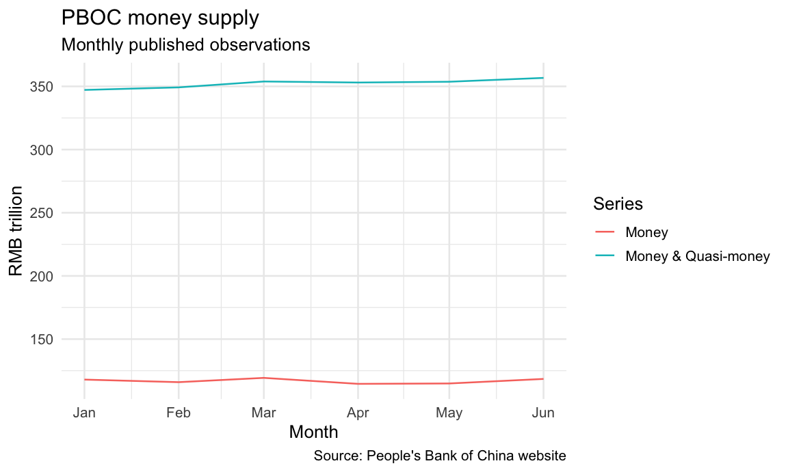

# readPBOC

[](https://github.com/chartwell-macro/readPBoC/actions/workflows/R-CMD-check.yaml)
[](https://github.com/chartwell-macro/readPBoC/blob/main/LICENSE)

`readPBOC` helps analysts and researchers discover, download, read, and
audit official statistical data published by the People’s Bank of China
(PBOC). It supports the Chinese and English PBOC statistics sites,
including their year and section indexes, spreadsheet attachments, HTML
tables, statistical-release indexes, release text, and revision-aware
download manifests.

> **Development release:** Install the current package from GitHub. Its
> documentation renders offline from packaged, provenance-recorded
> examples; live PBOC requests remain an explicit opt-in. A CRAN
> installation route will be added after the first release is accepted.

## What the package does

The package is organised around the way a data task is normally
performed:

| Task | Main functions | Input and result |
|----|----|----|
| Discover the archive | `pboc_years()`, `pboc_sections()`, `pboc_catalog()` | Official Chinese and English index pages; resource-index tibbles with stable `asset_id` and attachment `revision_id` values |
| Read and normalise a table | `pboc_read()`, `pboc_data()`, `pboc_tidy()` | Local paths, direct URLs, or catalog rows for XLS/XLSX workbooks and HTML tables; tibbles or named lists of tibbles |
| Read statistical releases | `pboc_releases()`, `pboc_read_release()` | Chinese or English release indexes and pages; release metadata, paragraphs, complete text, and attachment links |
| Preserve and compare history | `pboc_download()`, `pboc_snapshot()`, `pboc_revisions()` | Revision-safe local files, checksummed manifests, CSV snapshots, and `new`/`revised`/`unchanged`/`removed` classifications |

The normalised reader focuses on PBOC spreadsheets and HTML tables.
Catalogued PDF attachments can be preserved with `pboc_download()` and
passed to a PDF tool chosen for the downstream workflow.

## Installation

Install the development version from GitHub (repository access is
required while the repository is private):

``` r
install.packages("pak")
pak::pak("chartwell-macro/readPBoC")
```

For a local checkout, install the source package from its repository
root:

``` r
install.packages(".", repos = NULL, type = "source")
```

After `readPBOC` has an accepted CRAN release, the stable installation
route will be:

``` r
# After an accepted CRAN release:
install.packages("readPBOC")
```

The local parser examples use small, author-created structural fixtures
under the package’s MIT license. The chart example uses a separately
identified PBOC snapshot covered by the provenance and redistribution
terms in
[`inst/COPYRIGHTS`](https://github.com/chartwell-macro/readPBoC/blob/main/inst/COPYRIGHTS):

``` r
# Prefer the active source checkout so a stale installed package cannot change
# the rendered evidence; fall back to the installed package for end users.
package_file <- function(...) {
  pieces <- c(...)
  candidates <- c(
    do.call(file.path, as.list(c("inst", pieces))),
    system.file(..., package = "readPBOC")
  )
  candidates <- candidates[
    nzchar(candidates) & file.exists(candidates) & !dir.exists(candidates)
  ]
  if (!length(candidates)) {
    stop(
      "Packaged README file not found: ",
      paste(pieces, collapse = "/"),
      call. = FALSE
    )
  }
  candidates[[1L]]
}

worksheet_fixture <- package_file(
  "extdata", "readpboc-worksheet-fixture.csv"
)
html_fixture <- package_file("extdata", "readpboc-table-fixture.html")
money_snapshot_file <- package_file(
  "examples", "data", "pboc-current-series-values.rds"
)
```

## Data coverage, time spans, and gaps

Coverage is determined by the PBOC pages available for a language and
year; `readPBOC` does not impose one common start date or manufacture a
balanced panel. A year listed by `pboc_years()` means that a
year-labelled link was recognised, not that every series is present for
every period.

At a live check on 25 August 2026, `pboc_years("both")` returned Chinese
year rows from 1999 through 2026 and English year-labelled rows from
2001 through 2026. The sites are not translation mirrors. The same check
found six recognised Chinese sections for 2026—aggregate financing,
money and banking, balance sheets, credit funds, financial markets, and
CGPI—but no English section rows from the current English year-page
structure. English resources can appear later, under different
categories, or in different formats. Always inspect `language`,
`source_url`, `url`, and the number of matches rather than assuming a
Chinese workbook has an English counterpart.

The offline evidence packaged with version 0.1.3 is deliberately
narrower than the live archive:

| Packaged evidence | Coverage |
|----|----|
| Current-series catalog and values | 26 Chinese-source XLSX workbooks, 3,095 observations, 501 workbook/table/series combinations, and 217 distinct `series` labels |
| Subject groups | Aggregate financing (2 workbooks), CGPI (1), credit funds (9), financial markets (6), and money and banking (8) |
| Observation periods | Mostly January–June 2026; the six financial-market workbooks end in May, overseas-held RMB financial assets end in March, and the reserves/liquidity template is a 30 June point-in-time table |
| Release index | 740 Chinese rows dated 17 April 2001–15 July 2026 and 692 English rows dated 11 July 2002–15 July 2026 |

The numeric snapshot is sourced from the Chinese archive
(`language == "zh"`) even when a workbook supplies English labels. Every
stored observation has an English `series_en` label; 2,605 of 3,095 also
have `series_zh`, leaving 490 rows with an English-only series label.
The bilingual columns describe labels, not matched observations
downloaded independently from both sites. Likewise, Chinese and English
release-index rows are separate publications, not paired translations.

Stored snapshot rows have non-missing `period` and `value`, but absence
of a row must not be read as zero. Workbooks have different reporting
lags, and sparse series exist: in the packaged interbank pledged-repo
table, the six-month trading-volume series has no April 2026 row, while
the nine-month and one-year trading-volume series have no January or May
row. Check each selected series against its own expected frequency
before aggregation.

For a current coverage audit, run the discovery layers explicitly:

``` r
years <- pboc_years("both")
sections <- pboc_sections(2026, "both")
chinese_catalog <- pboc_catalog(2026, language = "zh")

list(
  years_by_language = split(years$year, years$language),
  sections_by_language = table(sections$language),
  chinese_workbooks_by_section = table(chinese_catalog$section_id)
)
```

The [Discovering and reading data
article](https://chartwell-macro.github.io/readPBoC/articles/discovering-and-reading-data.html#understand-coverage-before-reading)
shows how to audit a selected series for first/last period and missing
months.

## Retrieve and chart a time series

In a live analysis, `pboc_data()` discovers the matching PBOC catalog
entry, retrieves its workbook, and returns the normalised long-form
observations. This bounded call selects the 2026 Chinese Money Supply
workbook and its XLSX attachment:

``` r
money_supply <- pboc_data(
  year = 2026,
  section = "money_and_banking",
  item = "Money Supply|货币供应量",
  language = "zh",
  formats = "xlsx",
  sheet = 1,
  tidy = TRUE
)
```

For deterministic README and CRAN rendering, the code below uses the
packaged normalised snapshot of that same attachment revision
`2026071516481518348`, published on 15 July 2026. It retains the
official source URL, source coordinates, raw values, and unit metadata;
it is frozen evidence rather than a live cache. Set
`READPBOC_LIVE_EXAMPLES=true` only when deliberately refreshing live
examples.

The source unit is RMB 100 million, so divide `value` by 10,000 to
express the levels in RMB trillion. No additional reshaping package is
needed:

``` r
chart_data <- money_supply[
  money_supply$series %in% c("Money", "Money & Quasi-money") &
    !is.na(money_supply$value),
  c("series", "period", "value"),
  drop = FALSE
]
chart_data$date <- as.Date(
  paste0(sub("\\.", "-", chart_data$period), "-01")
)
chart_data$value <- chart_data$value / 10000
chart_data <- chart_data[order(chart_data$series, chart_data$date), ]
head(chart_data)
#> # A tibble: 6 × 4
#>   series period  value date
#>   <chr>  <chr>   <dbl> <date>
#> 1 Money  2026.01  118. 2026-01-01
#> 2 Money  2026.02  116. 2026-02-01
#> 3 Money  2026.03  119. 2026-03-01
#> 4 Money  2026.04  115. 2026-04-01
#> 5 Money  2026.05  115. 2026-05-01
#> 6 Money  2026.06  118. 2026-06-01
```

``` r
if (requireNamespace("ggplot2", quietly = TRUE)) {
  ggplot2::ggplot(
    chart_data,
    ggplot2::aes(x = date, y = value, colour = series, group = series)
  ) +
    ggplot2::geom_line() +
    ggplot2::labs(
      title = "PBOC money supply",
      subtitle = "Monthly published observations",
      x = "Month",
      y = "RMB trillion",
      colour = "Series",
      caption = "Source: People's Bank of China website"
    ) +
    ggplot2::theme_minimal(base_size = 13)
}
```



Required source attribution: 稿件来源：中国人民银行网站 (Source:
People’s Bank of China website).

The same `series`, `period`, and numeric `value` columns are returned by
the live call, so the filtering, date conversion, unit conversion, and
chart code are unchanged. The [Getting Started
article](https://chartwell-macro.github.io/readPBoC/articles/getting-started.html#retrieve-and-chart-a-time-series)
shows the explicit `pboc_catalog()` to `pboc_read()` version of this
workflow.

## Read and normalise a local table

`pboc_tidy()` turns worksheet-shaped cells into auditable long-form
values. The packaged CSV is an author-created structural fixture whose
synthetic labels and values make the parser’s offline behaviour
reproducible:

``` r
fixture_cells <- utils::read.csv(
  worksheet_fixture,
  header = FALSE,
  check.names = FALSE,
  stringsAsFactors = FALSE,
  na.strings = ""
)
fixture_tidy <- pboc_tidy(fixture_cells)
fixture_tidy[, c("series", "period", "value", "value_raw")]
#> # A tibble: 4 × 4
#>   series           period  value value_raw
#>   <chr>            <chr>   <dbl> <chr>
#> 1 Example series A 2025.01   1   1
#> 2 Example series A 2025.02   2   2
#> 3 Example series B 2025.01   3.5 3.5
#> 4 Example series B 2025.02   4   4
```

The normalised result is a tibble. Its `period` values retain the source
period labels after canonical month normalisation where applicable;
`value` contains numeric observations and `value_raw` retains the source
text. The `series_zh` and `series_en` columns preserve bilingual labels
when the source provides them. `source_row` and `source_column` point
back to the worksheet, and notes detected on the normalised path are
kept in the `notes` attribute. Empty, period-column, and no-header
fallback results may not have that attribute; the fallback instead
carries the retained row numbers in `attr(x, "source_rows")`.

The paired HTML file is another small synthetic structural fixture under
the same license. `pboc_read()` reads it locally without downloading or
writing a persistent cache:

``` r
fixture_html <- pboc_read(html_fixture)
if (is.data.frame(fixture_html)) {
  head(fixture_html)
} else {
  names(fixture_html)
}
#> # A tibble: 2 × 3
#>   Item             `2025.01` `2025.02`
#>   <chr>                <dbl>     <int>
#> 1 Example series A       1           2
#> 2 Example series B       3.5         4
```

For a workbook read from a catalog row or URL, `pboc_read()` returns the
first sheet by default. Set `sheet = NA` to receive a named list of all
non-empty sheets, or set `tidy = TRUE` to apply `pboc_tidy()` to a
sheet.

## Discover and select PBOC data

Discovery functions make network requests to the official PBOC sites.
They return ordinary tibbles with explicit source URLs, rather than
hiding the selected page or attachment:

``` r
years <- pboc_years("both")
current_year <- max(years$year, na.rm = TRUE)
sections <- pboc_sections(current_year, "both")
catalog <- pboc_catalog(
  current_year,
  language = "zh",
  section = "money",
  formats = c("xlsx", "xls")
)
head(catalog[, c("asset_id", "item", "format", "published_at", "url")])
```

The `section` and `item` arguments are regular-expression filters over
the canonical section identifiers and bilingual titles. Use a narrower
`item` when a section contains more than one workbook.
`language = "auto"` in `pboc_data()` prefers the Chinese archive and
falls back to English when the Chinese catalog request fails or the
requested match is not available:

``` r
money_live <- pboc_data(
  year = current_year,
  section = "money",
  item = "Money Supply|货币供应量",
  language = "auto",
  tidy = TRUE
)
head(money_live[, c("series", "period", "value")])
```

Set `READPBOC_LIVE_EXAMPLES=true` when you want these bounded live calls
while rendering the README. The default path uses packaged evidence and
works in offline documentation builds.

## Read, tidy, and audit a selected resource

`pboc_read()` accepts any of the following:

- a local XLS/XLSX or HTML path;
- a direct HTTP(S) URL; or
- one row from `pboc_catalog()`.

For spreadsheets, `tidy = FALSE` preserves the source worksheet geometry
and `tidy = TRUE` returns the long-form contract described above. A
direct URL is downloaded to a temporary file for the duration of the
call. The result has `source_url` and, for local paths, `source_path`
attributes so that a result can be traced to its source.

``` r
record <- catalog[1L, , drop = FALSE]
raw_sheet <- pboc_read(record, sheet = 1, tidy = FALSE)
tidy_sheet <- pboc_read(record, sheet = 1, tidy = TRUE)
all_sheets <- pboc_read(record, sheet = NA, tidy = FALSE)

head(tidy_sheet[, c("series", "period", "value", "source_row")])
names(all_sheets)
```

When a workbook has an irregular bilingual header, `pboc_tidy()` keeps
the raw cell text and source coordinates rather than silently discarding
cells. Inspect `value_raw`, `notes`, `source_row`, and `source_column`
when auditing an unexpected value.

## Statistical releases

`pboc_releases()` discovers release pages by language and category. The
English site separates categories such as `financial_statistics` and
`aggregate_financing`; the Chinese feed combines several kinds of
interpretation and release pages. `pboc_read_release()` returns a
`pboc_release` list with `title`, `published_at`, `language`,
`category`, `text`, `paragraphs`, `attachments`, and `url` components.

``` r
releases <- pboc_releases(
  language = "en",
  category = "financial_statistics",
  pages = 1L
)
if (nrow(releases)) {
  release <- pboc_read_release(releases[1L, , drop = FALSE])
  release[c("title", "published_at", "language", "category", "url")]
}
```

## Preserve downloads and compare revisions

`pboc_download()` names files with the item and PBOC attachment
identifier, records the source URL, revision, size, checksum, and
retrieval time, and does not overwrite an existing revision unless
`overwrite = TRUE`. A manifest is written inside the destination
directory by default. Use a project data directory for durable
retrievals; the temporary directory is appropriate for examples and
exploratory work:

``` r
download_dir <- file.path(tempdir(), "readPBOC-download")
downloaded <- pboc_download(catalog[1L, , drop = FALSE], download_dir)
downloaded[, c("status", "revision_id", "path", "md5")]
```

Save a catalog before a refresh and compare it with a later catalog to
make changes explicit:

``` r
snapshot_path <- file.path(tempdir(), "readPBOC-catalog.csv")
pboc_snapshot(catalog, snapshot_path)
changes <- pboc_revisions(snapshot_path, snapshot_path)
head(changes[, c("asset_id", "status")])
```

In a real refresh, pass the earlier snapshot as `previous` and the newly
created catalog (or its saved CSV) as `current`. `pboc_revisions()`
compares the stable `asset_id` and reports `new`, `removed`, `revised`,
or `unchanged`; it does not change either input.

Any catalog or value snapshots bundled for tests, examples, or
dashboards are frozen evidence artifacts. They are not a live cache and
should not be treated as the current PBOC release. Refresh your own
catalog and attachment files when reproducibility requires a new
observation date.

## Output contract

The exported functions return these stable structures:

- `pboc_years()` returns one row per available `year` and `language`,
  with archive `title`, `url`, and `source_url` columns.
- `pboc_sections()` adds `section_id`, `section`, `section_zh`,
  `section_en`, `url`, and `source_url` to the selected year and
  language.
- `pboc_catalog()` returns `asset_id`, `revision_id`, `year`,
  `language`, `section_id`, `section`, `item`, `item_zh`, `item_en`,
  `period`, `format`, `published_at`, `url`, and `source_url`.
- On its normalised path, `pboc_tidy()` returns `table`, `series`,
  `series_zh`, `series_en`, `period`, numeric `value`, character
  `value_raw`, `unit`, `source_row`, and `source_column`; detected notes
  are stored in `attr(x, "notes")`. Its documented no-header fallback
  instead returns a cleaned wide tibble with `attr(x, "source_rows")`.
- `pboc_download()` returns `asset_id`, `revision_id`, `status`,
  `downloaded_at`, `published_at`, `url`, `path`, `size`, and `md5`.
- `pboc_read_release()` returns a `pboc_release` list with `release_id`,
  `language`, `category`, `title`, `published_at`, `text`, `paragraphs`,
  `attachments`, and `url`; `attachments` is a tibble with `title`,
  `format`, and `url`.
- `pboc_revisions()` returns the stable `asset_id`, a `status`, and the
  previous/current revision and URL columns.

Resource indexes carry a `pboc_resource_index` class in addition to the
tibble classes; release indexes carry `pboc_release_index`.
`pboc_read()` returns a tibble for one table, a named list of tibbles
for `sheet = NA`, or the HTML table result. `pboc_snapshot()` returns
its CSV path invisibly.

## Reproducible network and storage behaviour

PBOC pages and attachments are public, so package workflows require no
account or API key. Requests use HTTP(S), follow redirects, send a
package user-agent, and use a 60-second timeout by default. Discovery
and release-page requests make up to three total attempts after
transient transport errors, HTTP 5xx responses, or HTTP 429 responses.
Direct attachment reads and downloads make one transfer. You can
identify your client and adjust the timeout for a session with:

``` r
options(
  readPBOC.user_agent = "my-analysis/0.1",
  readPBOC.timeout = 30
)
```

Package installation and startup are offline. `pboc_read()` uses and
removes a temporary file for a remote attachment, while
`pboc_download()` and `pboc_snapshot()` write to caller-selected paths.
Use `tempdir()` for disposable work and a project-managed directory for
persistent files. Retain the selected catalog row or manifest with live
results so archive updates, rate limits, and temporary outages remain
auditable.

## Scope and limitations

- **No matching resource:** discovery filters are regular expressions.
  Check `pboc_years()` and `pboc_sections()` first, then broaden
  `section` or `item`; include both Chinese and English text when
  comparing sites.
- **Several workbooks matched:** narrow `item` or `section`.
  `pboc_data()` stops rather than choosing an arbitrary asset when more
  than one conceptual item matches.
- **PDF or CSV input:** PDFs can be catalogued and downloaded but are
  not normalised by `pboc_read()`; CSV is not a supported PBOC
  attachment format. Retain the official PDF with `pboc_download()` or
  convert data through a deliberate, auditable step before calling
  `pboc_tidy()`.
- **Network failure or timeout:** check access to
  `https://www.pbc.gov.cn`, set a suitable `readPBOC.timeout`, and retry
  later. A failed request raises an error; it does not create a partial
  manifest entry.
- **Unexpected values or periods:** inspect `value_raw`, `unit`,
  `source_row`, `source_column`, `attr(result, "notes")`, and, for a
  warned wide fallback, `attr(result, "source_rows")`. The normaliser
  handles common irregular bilingual headers and dated rows, not every
  possible workbook layout.
- **HTML tables:** `pboc_read()` exposes the table structure returned by
  `rvest`; HTML tables are not passed through `pboc_tidy()`
  automatically.

## Citation, licensing, and contributing

The package code, documentation, and synthetic fixtures are copyright
Chartwell Macro and released under the [MIT
license](https://github.com/chartwell-macro/readPBoC/blob/main/LICENSE).
Bundled normalised snapshots and generated dashboard artifacts derived
from PBOC material remain PBOC source material and are not asserted to
be public domain or covered by that license. The maintainer confirms
permission to redistribute those existing artifacts with the package,
including through CRAN and its mirrors. PBOC retains copyright; preserve
the source attribution and provenance described in
[`inst/COPYRIGHTS`](https://github.com/chartwell-macro/readPBoC/blob/main/inst/COPYRIGHTS).
Retain source URLs and publication/revision identifiers in analyses.
After installing the package, `citation("readPBOC")` prints the package
citation metadata. The package author and maintainer is Chartwell Macro.

Please report reproducible parser failures, changed PBOC page
structures, and feature proposals to [chartwellmacro@gmail.com](mailto:chartwellmacro@gmail.com). Code and
documentation contributions can be proposed through [pull
requests](https://github.com/chartwell-macro/readPBoC/pulls). For security concerns, email [chartwellmacro@gmail.com](mailto:chartwellmacro@gmail.com) privately.

The generated reference site, when published, is available at
<https://chartwell-macro.github.io/readPBoC/>.
